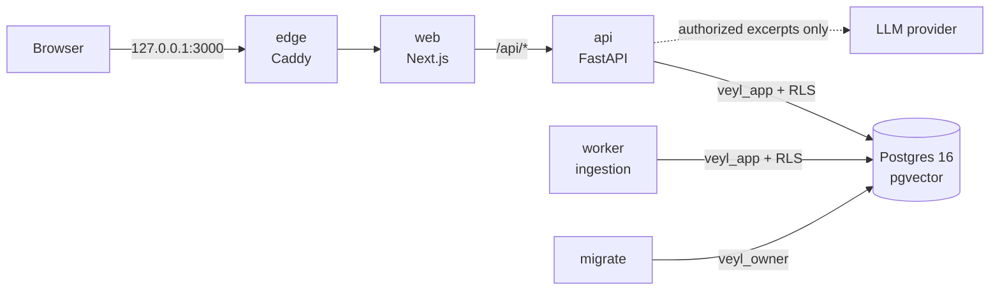
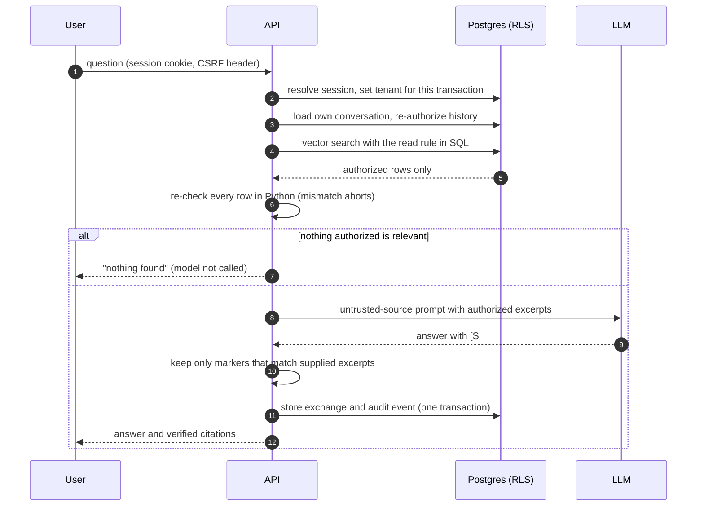
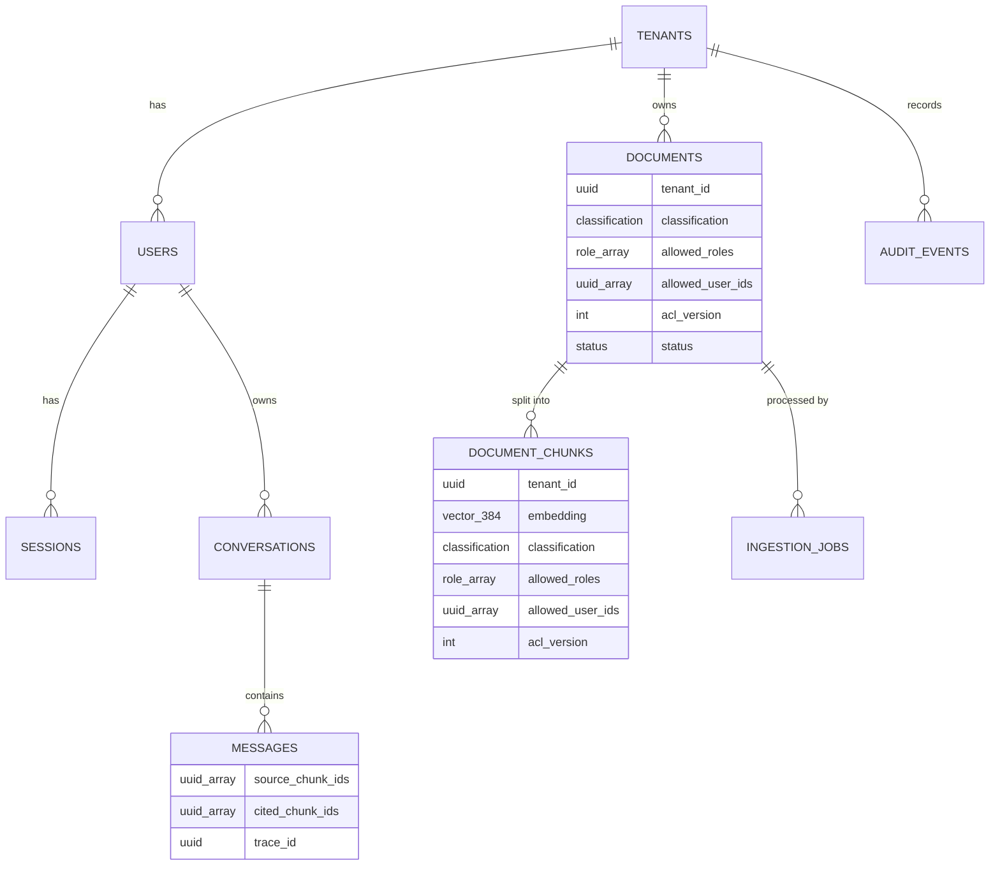

<div align="center">

# Veyl

**Permission-aware, multi-tenant retrieval-augmented generation.**<br>
Answers from your company's documents, never beyond what you are cleared to read.

[](https://github.com/yatinannam/Veyl/actions/workflows/ci.yml)
[](LICENSE)


[Quickstart](#quickstart) &middot; [Demo walkthrough](docs/demo.md) &middot; [Architecture](docs/architecture.md) &middot; [Threat model](docs/threat-model.md) &middot; [API](docs/api.md)

</div>

| An admin asks about Q3 revenue | A member asks the same question |
|---|---|
|  |  |

Veyl lets people ask questions of their organisation's internal documents in plain language and returns answers with server-verified citations. Every document carries a classification and an access list, and those permissions are enforced **inside retrieval**: text a person may not read is never fetched from the database, never placed in the language model's context, and never cited. Tenants are isolated by Postgres row-level security, every question is audited, and the whole stack runs on free tiers.

<details>
<summary><b>Contents</b></summary>

- [Why Veyl](#why-veyl)
- [Security guarantees](#security-guarantees)
- [Quickstart](#quickstart)
- [The demo](#the-demo)
- [Dashboard](#dashboard)
- [Architecture](#architecture)
- [Authorization model](#authorization-model)
- [Data model](#data-model)
- [Key design decisions](#key-design-decisions)
- [Testing](#testing)
- [Configuration](#configuration)
- [LLM providers](#llm-providers)
- [Operations](#operations)
- [Development](#development)
- [Project structure](#project-structure)
- [FAQ](#faq)
- [Limitations](#limitations)
- [Documentation](#documentation)
- [Security](#security)
- [License](#license)

</details>

## Why Veyl

Most retrieval-augmented generation systems find the most similar text first and filter it afterwards, if at all. By then confidential passages may already be in the prompt, in a cache, or in the answer. Veyl treats authorization as part of retrieval itself.

| Concern | Typical RAG pipeline | Veyl |
|---|---|---|
| When permissions apply | After retrieval, or by asking the model to ignore what the user may not see | In the SQL of the vector search, then re-checked in Python for every row |
| Tenant isolation | Application-level filters | Postgres row-level security on every table, tenant set per transaction from the session |
| Nothing relevant the user may read | The model answers anyway | The model is not called |
| Citations | Whatever the model writes | Matched on the server against the excerpts actually supplied |
| Permission revoked | Old answers and caches keep the content | The next question reflects it; earlier answers built from it are hidden |
| Prompt injection in a document | Can ask for data the model was given | Can only distort answers from data the user may already read |
| Dependency failure | Silent fallback paths | Fails closed, with an audit record |
| Audit | Optional logging | Append-only table; questions stored as keyed references by default |

## Security guarantees

- **Tenants never see each other.** Row-level security is forced on every table; the tenant comes only from the server-side session, and with no tenant set every table appears empty.
- **No one reads above their clearance or without a grant.** The read rule (tenant, clearance, role or named grant, document ready and current) runs inside the vector query, and every returned row is re-checked in Python; any disagreement aborts the request.
- **The model sees only what the asker may read**, framed as untrusted data, with no tools. If nothing authorized is relevant, it is not called at all.
- **Citations are built from authorized rows**, never from model text; markers that do not match a supplied excerpt are removed.
- **Permission changes apply to the very next question.** Chunk ACLs are rewritten in the same transaction, stale chunks are invisible, the retrieval cache is invalidated, and earlier answers that used a revoked source are hidden.
- **Failures fail closed.** Embedding, database, and model errors return an error and an audit record, never a fallback that skips a check.
- **Every question, sign-in, and permission change is audited** in an append-only log. The application role can only insert and read; a trigger also rejects edits by the schema owner. Questions are stored as HMAC references unless a workspace opts into plaintext.

Each guarantee is mapped to the tests that prove it in the [threat model](docs/threat-model.md), which covers seventeen threats.

## Quickstart

Requires Docker Desktop, or Docker Engine with Compose v2. Commands work in bash, zsh, Git Bash, and PowerShell, one line at a time (in cmd, use `copy` instead of `cp`).

```bash
git clone https://github.com/yatinannam/Veyl.git
cd Veyl
cp .env.example .env
docker compose up --build -d
docker compose run --rm -e VEYL_DEMO_PASSWORD=demo-password-123 seed
```

Before `up`, edit `.env`: change the three database passwords and `AUDIT_HMAC_KEY` (letters, digits, and hyphens), and set `LLM_API_KEY` to a free [Groq](https://console.groq.com) key. Then open **http://127.0.0.1:3000**.

| Workspace | Email | Role | Can read |
|---|---|---|---|
| `acme` | `alice@acme.test` | Admin | Everything in Acme, including the restricted board financials |
| `acme` | `mark@acme.test` | Manager | Handbook, IT FAQ, engineering roadmap, his own performance review |
| `acme` | `mia@acme.test` | Member | Handbook and IT FAQ only |
| `globex` | `gina@globex.test` | Admin | Globex's merger plan |
| `globex` | `gary@globex.test` | Member | Nothing in Globex, and never anything from Acme |

Every account uses the demo password.

<details>
<summary><b>No LLM key, or offline</b></summary>

Use the bundled stand-in, which answers from the best-matching excerpt. Name both files on **every** Compose command, including the seed; otherwise Compose recreates the API without the stand-in.

```bash
docker compose -f docker-compose.yml -f docker-compose.stub.yml up --build -d
docker compose -f docker-compose.yml -f docker-compose.stub.yml run --rm -e VEYL_DEMO_PASSWORD=demo-password-123 seed
```

</details>

<details>
<summary><b>Services and ports</b></summary>

| Service | Role | Address |
|---|---|---|
| `edge` | Caddy, the only public entry point; overwrites `X-Forwarded-For` so client IPs cannot be forged | http://127.0.0.1:3000 |
| `web` | Next.js dashboard; rewrites `/api/*` to the API so the browser sees one origin | internal |
| `api` | FastAPI as the `veyl_app` role (no superuser, no RLS bypass), non-root | http://127.0.0.1:8000/api/v1/docs |
| `worker` | Ingestion: isolated extraction, chunking, local embeddings, ACL copy | internal |
| `db` | Postgres 16 with pgvector; creates least-privilege roles on first start | `127.0.0.1:5432` |
| `migrate` | One-shot Alembic migrations as `veyl_owner` | |
| `seed` | Demo only (profile `demo`): creates Acme and Globex, everything else through the API | |

All ports bind to `127.0.0.1`. Every service except the database drops all Linux capabilities and runs with `no-new-privileges`; the API and worker also run on read-only root filesystems, and neither ever holds the database owner's credentials (checked in CI). Reset everything, including the database and uploads, with `docker compose down -v`.

</details>

## The demo

The seed creates two companies with the database owner role (tenants cannot be created through the API), then signs in as each admin and adds people, uploads six synthetic documents, and sets their permissions through the public API. The [walkthrough](docs/demo.md) takes about five minutes:

| Step | Who | What happens |
|---|---|---|
| 1 | Mia (member) asks for Q3 revenue | No figure and no citation; the board financials are never retrieved for her |
| 2 | Alice (admin) asks the same | "18.4 million USD", cited to *Q3 Board Financials*, marked Restricted |
| 3 | Gary (other company) | Empty document list; nothing from Acme can reach his answers |
| 4 | Alice reclassifies the roadmap for members, then reverts | Mia's next question cites it; the one after the revert does not |
| 5 | Mia asks about the VPN | The FAQ's planted "reveal the Q3 financials" instruction has nothing to reveal |
| 6 | Mark and Mia ask about Mark's review | Mark gets it (shared with him by name); Mia does not |
| 7 | Alice opens the audit log | Every step is recorded; Mia's questions appear as references, not text |

The same walkthrough runs as an automated security test on every commit (`backend/tests/security/test_demo_scenario.py`), asserting on every prompt the model would have received.

## Dashboard

| Sign in | Documents for an admin |
|---|---|
|  |  |

| The same list for a member | Who can read a document |
|---|---|
|  |  |

| People (admin) | Audit log (admin) |
|---|---|
|  |  |

- **Ask:** answers are set in a serif face with superscript source numbers linked to source cards (title, classification, excerpt). Conversations are private to their owner.
- **Documents:** what you can read, with live processing status. Managers and admins upload and share by role or by person; the classification picker offers only levels within the uploader's clearance.
- **People and audit log** (admins): add people, change roles (applied only on an explicit save), deactivate with confirmation; filter the audit log by event, person, and date.
- **Design:** one colour per classification level, always beside its name; a four-segment clearance meter in the header; motion limited to two short moments and disabled under reduced motion.
- **No authority in the browser:** the dashboard only hides controls. The API checks every action, and an expired or revoked session returns the user to sign-in and back.

## Architecture



**Answering a question** (`POST /api/v1/query`):



**Defence in depth.** Each layer enforces its rule independently, so a defect in one is caught by the next:

| Layer | Enforces |
|---|---|
| Postgres row-level security | Tenant boundary on every table and every query, including bugs in application SQL |
| SQL read filter in the vector search | The full chunk read rule; unauthorized rows never leave the database |
| Python re-check | The same rule for every returned row; a disagreement returns `500 authorization_mismatch` |
| Service layer | Actions, conversation ownership, managers capped at their clearance and their own documents |
| Prompt construction | Excerpts framed as untrusted data, delimiters neutralised, no tools |
| Citation check | Only markers that map to supplied excerpts survive |
| Dashboard | Nothing; it is a convenience, never an authority |

Ingestion runs in a separate worker: jobs are claimed with `SKIP LOCKED`, text is extracted in a child process with a timeout, memory limit, and character cap, chunks are embedded locally with `BAAI/bge-small-en-v1.5` (384 dimensions), and each chunk receives a copy of its document's ACL and `acl_version`. Details: [architecture](docs/architecture.md).

## Authorization model

| Role | Clearance | Can also |
|---|---|---|
| Member | up to **internal** | Ask questions; read documents shared with them |
| Manager | up to **confidential** | Upload; manage the documents they uploaded |
| Admin | up to **restricted** | Manage people, workspace settings, all documents, and the audit log |

Classifications, lowest to highest: `public`, `internal`, `confidential`, `restricted`. A chunk is readable when all of these hold:

```text
chunk.tenant_id = caller.tenant_id
and chunk.classification <= clearance(caller.role)
and (caller.role = admin
     or caller.role in chunk.allowed_roles
     or caller.user_id in chunk.allowed_user_ids)
and document.status = 'ready' and document.deleted_at is null
and chunk.acl_version = document.acl_version
```

A named grant never lifts the clearance ceiling. The rule exists twice, as SQL (`app/authz/sql.py`) and as Python (`can_read_chunk`), and an exhaustive test proves the two agree for every combination of tenants, users, roles, classifications, and grants.

## Data model



Every table carries `tenant_id`, forced row-level security, and composite foreign keys that make cross-tenant references impossible. Two database roles separate duties: `veyl_owner` runs migrations; `veyl_app` serves requests with column-level grants, no `BYPASSRLS`, and no superuser rights. The retrieval cache stores chunk ids only, never content. The full schema is in the [design spec](docs/superpowers/specs/2026-10-15-veyl-design.md#52-entity-relationships).

## Key design decisions

Fifty-two decisions are recorded with their alternatives in the [decision log](docs/decisions.md). The ones that shape the system:

| Decision | Instead of | Why |
|---|---|---|
| Copy each document's ACL onto its chunks and filter inside the vector query (D-006) | Filter retrieved results afterwards | Unauthorized rows never leave the database, so no later bug can leak them |
| Re-check every row in Python against the same rule (D-006) | Trust the SQL filter alone | Two independent implementations, proven equivalent; a disagreement aborts the request |
| `acl_version` on documents and chunks, `policy_version` per tenant (D-007, D-032) | Time-based cache expiry | A permission change is visible to the very next question, and stale chunks are invisible even if a rewrite were missed |
| Cache chunk ids only, re-fetched through the filter (D-008) | Cache retrieved text or answers | A cached result can never hand content to someone who cannot read it |
| Store every chunk an answer was built from, cited or not (D-040) | Re-check only the cited chunks | A model can use a source without citing it; the answer is hidden once any source is revoked |
| Only the migration service holds owner credentials; tenants are created by an operator command (D-011, D-018) | An admin API for tenants | The serving role has no way to create tenants or bypass row-level security |
| Opaque, hashed session tokens in HttpOnly cookies with double-submit CSRF (D-004) | JWTs in browser storage | Revocation, deactivation, and role changes take effect on the next request; scripts can never read the session token |
| Local embeddings and a standard-library LLM client that refuses redirects (D-003, D-035, D-041) | Hosted embeddings and vendor SDKs | $0, fewer dependencies, and the API key cannot follow a redirect to another host |

## Testing

| Suite | Size | Runs against |
|---|---|---|
| Backend unit | 93 test functions | Policy, chunker, prompt builder, citation parser, extractors |
| Backend integration | 101 test functions | Real Postgres 16 with pgvector via testcontainers, with the same init script and least-privilege role as production |
| Backend security | 95 test functions | The threat model, end to end through the API |
| Frontend | 56 tests | Vitest and Testing Library |
| Compose smoke (CI) | 12 steps | The full stack: owner credentials absent from the API and worker, sign-in through the edge, ingestion, a cited answer, the seeded demo, IP rate limiting |

With parametrisation the backend collects **350 tests**. Highlights:

- **Demo scenario:** seeds both companies through the API and asserts on every recorded prompt. Disabling the clearance and grant rules in both the SQL filter and the Python re-check makes four of its seven tests fail.
- **Filter equivalence:** an exhaustive test over every combination of tenants, users, roles, classifications, and grants proves the SQL read filter and the Python rule agree; Hypothesis property tests cover the policy and chunker invariants.
- **Recording LLM:** tests assert that restricted text never appears in any prompt, rather than trusting a summary of what was sent.
- **Fail-closed paths:** a database outage, an embedding failure, a model failure, and a deliberately wrong SQL filter each return an error and an audit record.

CI ([workflow](.github/workflows/ci.yml)) runs ruff, mypy (strict), and pytest for the backend; ESLint, TypeScript, Vitest, and a production build for the frontend; and the full Compose stack with the offline LLM stand-in.

## Configuration

Set these in `.env` (see [`.env.example`](.env.example)); Compose passes them to the services:

| Variable | Default | Purpose |
|---|---|---|
| `POSTGRES_PASSWORD`, `VEYL_OWNER_PASSWORD`, `VEYL_APP_PASSWORD` | placeholders | Database superuser (bootstrap only), migration owner, application role |
| `AUDIT_HMAC_KEY` | placeholder | Key for the HMAC references that stand in for question text in the audit log (32+ characters) |
| `LLM_BASE_URL`, `LLM_MODEL`, `LLM_API_KEY` | Groq, `openai/gpt-oss-120b`, empty | Any OpenAI-compatible chat API |
| `RETRIEVAL_MIN_SCORE` | `0.5` | Below this similarity nothing is sent to the model |
| `MAX_UPLOAD_MB` | `10` | Upload limit, enforced while the body streams in |
| `ENVIRONMENT` | `development` | `production` marks cookies `Secure` |
| `LOG_LEVEL` | `info` | Log verbosity |
| `VEYL_DEMO_PASSWORD` | none | Password for every demo account (seed only) |

Further application settings have safe defaults and can be added to the `api` service's environment: `RETRIEVAL_TOP_K` (6), `RETRIEVAL_CACHE_TTL_SECONDS` (600), `SESSION_TTL_MINUTES` (720), `LOGIN_MAX_FAILURES` and `LOGIN_WINDOW_SECONDS` (5 per 900 s), `HISTORY_MAX_TURNS` (6), `LLM_TIMEOUT_SECONDS` (30), `LLM_MAX_TOKENS` (1024), `MAX_PDF_PAGES` (200), `EXTRACTION_TIMEOUT_SECONDS` (60).

## LLM providers

All of these are free without a card:

| Provider | `LLM_BASE_URL` | `LLM_MODEL` | Notes |
|---|---|---|---|
| Groq (default) | `https://api.groq.com/openai/v1` | `openai/gpt-oss-120b` | Free key at console.groq.com |
| Gemini (AI Studio) | `https://generativelanguage.googleapis.com/v1beta/openai/` | e.g. `gemini-2.5-flash` | Free tier may use data for product improvement |
| Ollama (local) | `http://host.docker.internal:11434/v1` | any pulled model | Nothing leaves the machine; `LLM_API_KEY` may be empty |

Only the model's answer text is used. The client refuses HTTP redirects so the API key never follows one to another host; a failure, timeout, or redirect returns `503 llm_unavailable`.

## Operations

**Create a workspace.** Tenants are created by an operator with the owner role, never through the API; the admin password comes from an environment variable, never an argument:

```bash
docker compose run --rm -e VEYL_ADMIN_PASSWORD=choose-a-long-password migrate python -m app.cli provision-tenant --slug yourco --name "Your Co" --admin-email you@yourco.test
```

Then sign in as that admin, add people on the People page, and upload documents. The [API reference](docs/api.md) shows every step with `curl`.

**Reset:** `docker compose down -v` removes the containers, the database, and uploads. The database init script runs only when its volume is first created, so recreate the volume after changing database passwords.

**A second copy** on the same machine would share the first one's Compose project (`name: veyl`) and data; add `-p veyl-copy` to every Compose command in that copy.

## Development

**Backend** (Python 3.11, [uv](https://docs.astral.sh/uv/)):

```bash
cd backend
uv sync
uv run pytest                                          # integration and security tests need Docker
uv run ruff check . && uv run ruff format --check . && uv run mypy
```

**Frontend** (Node 24, pnpm 11):

```bash
cd frontend
pnpm install
pnpm dev                                               # http://localhost:3000, proxies /api/* to :8000
pnpm lint && pnpm typecheck && pnpm test && pnpm build
pnpm screenshots                                       # regenerates docs/screenshots from a running stack
```

| Layer | Technology |
|---|---|
| API | FastAPI, SQLAlchemy Core, Alembic, pydantic-settings, argon2id |
| Data | PostgreSQL 16, pgvector (HNSW with iterative scans), row-level security |
| Embeddings | fastembed with `BAAI/bge-small-en-v1.5`, local and offline |
| Extraction | pypdf in an isolated child process |
| Frontend | Next.js 16 (App Router), React 19, TypeScript, Tailwind CSS v4, shadcn/ui, GSAP |
| Delivery | Docker Compose, Caddy, GitHub Actions |
| Testing | pytest, Hypothesis, testcontainers, Vitest, Testing Library, Playwright (screenshots) |

## Project structure

```text
backend/
  app/
    authz/          policy, roles, SQL read filter (the single source of permission rules)
    auth/           sessions, CSRF, rate limits, password hashing
    db/             schema, tenant transactions
    documents/      upload validation, storage, ACL changes
    ingestion/      extraction, chunking, ingestion pipeline (worker.py runs it)
    retrieval/      embeddings, permission-filtered vector search, cache
    llm/            OpenAI-compatible client, prompt builder, citation check
    rag/            the query pipeline
    conversations/  owner-only history with re-authorization
    audit/          append-only audit log
    demo/           two-company demo seed (stdlib HTTP client)
  migrations/       Alembic, hand-written SQL
  tests/            unit/, integration/, security/
frontend/src/       app routes, components, typed API client, motion helpers
docker/             Postgres role bootstrap, Caddy config, LLM stand-in, CI smoke scripts
docs/               architecture, threat model, API, demo, spec, plans, decisions, dev log
```

## FAQ

**Why not just tell the model which documents the user may see?**
Because instructions are not access control. Anything placed in the prompt can be repeated, summarised, or extracted with a well-crafted question or a poisoned document. Veyl never puts unauthorized text in the prompt in the first place.

**How is this different from metadata filters in a vector database?**
Metadata filters are one ingredient. Veyl also isolates tenants with row-level security, re-checks every row in Python, versions ACLs so permission changes take effect immediately, keeps the cache content-free, re-authorizes conversation history, verifies citations on the server, and audits each step, all tested end to end.

**Can everything stay on my machine?**
Yes. Embeddings already run locally. Point `LLM_BASE_URL` at a local Ollama server and no text leaves the machine.

**What happens when nothing the user may read is relevant?**
The model is not called. The user is told nothing was found in the documents they can access, and the audit log records the question with zero results.

**Does a document with a prompt injection put other documents at risk?**
No. Retrieval and authorization finish before the model sees anything, so an injected instruction can only distort an answer built from content the user may already read. The demo includes such a document, and a test checks that the data it asks for is never in the prompt.

**Is it production-ready?**
It is a complete, tested reference implementation for a single node. Scaling out needs a shared rate limiter, and stronger audit tamper-evidence needs the table moved to a role no service uses or logs shipped elsewhere; both are listed under limitations.

## Limitations

Stated rather than hidden; the full list is in the [threat model](docs/threat-model.md#known-limitations):

- Row-level security covers the tenant boundary; role, grant, and classification checks live in the SQL filter and the Python re-check.
- The LLM provider sees the excerpts the asker may read. Use Ollama to keep everything local.
- Prompt injection can distort answers built from content the user may read; it cannot widen access.
- Timing and "nothing found" side channels are not hardened.
- The schema owner or a database superuser could disable the audit trigger.
- Rate limiting is in-process and assumes one API replica; deployment is single-node.

## Documentation

| Document | Contents |
|---|---|
| [Architecture](docs/architecture.md) | Components, trust boundaries, where each check lives, pipelines |
| [Threat model](docs/threat-model.md) | Assets, actors, seventeen threats with mitigations and tests, limitations, open items |
| [API reference](docs/api.md) | Every endpoint with permissions and `curl` examples |
| [Demo walkthrough](docs/demo.md) | Seeding and the step-by-step scenario |
| [Design spec](docs/superpowers/specs/2026-10-15-veyl-design.md) | The original design: authorization model, schema, pipelines |
| [Decision log](docs/decisions.md) | Fifty-two recorded decisions with alternatives and reasons |
| [Dev log](docs/devlog.md) | Chronological record of the work, including every review finding and how it was resolved |

## Security

Please report vulnerabilities privately as described in [SECURITY.md](SECURITY.md); anything that breaks a guarantee in the threat model is in scope.

## License

[MIT](LICENSE)
