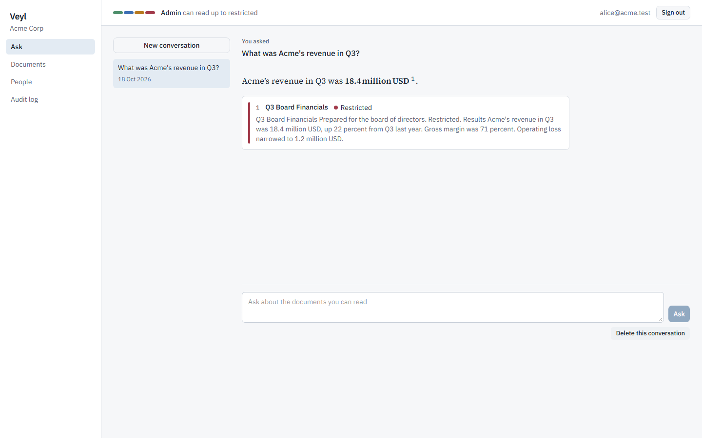
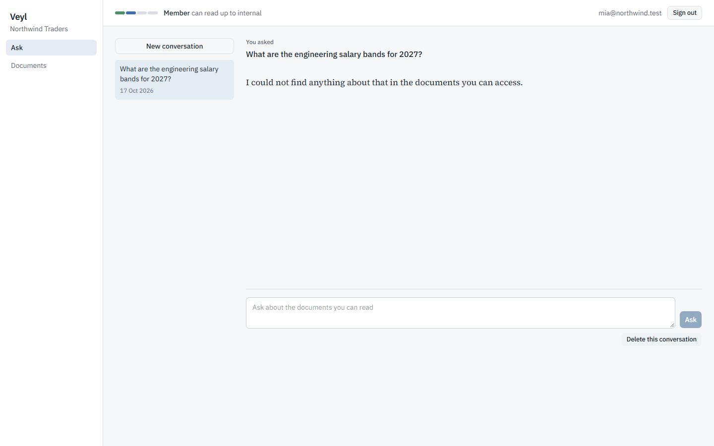
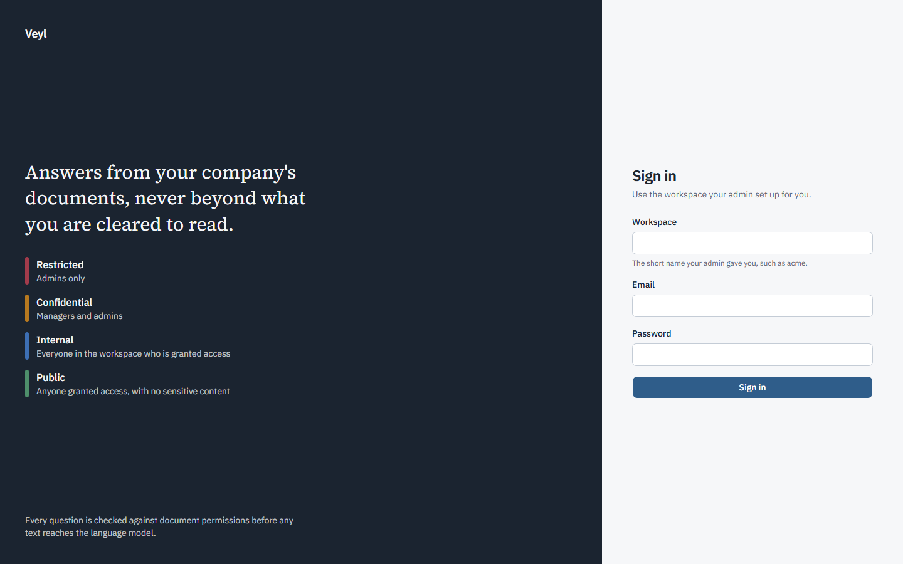
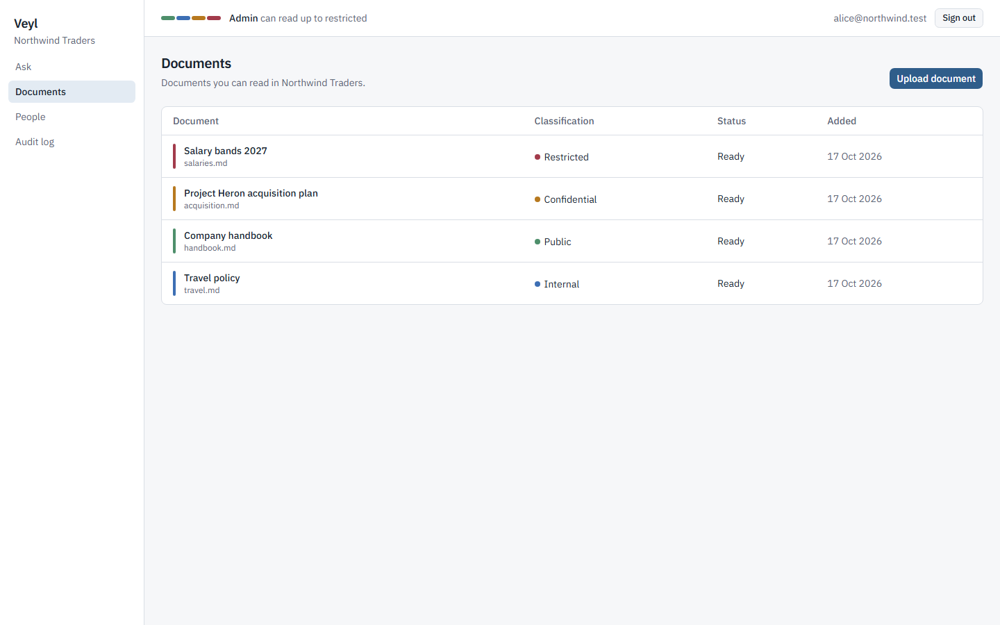
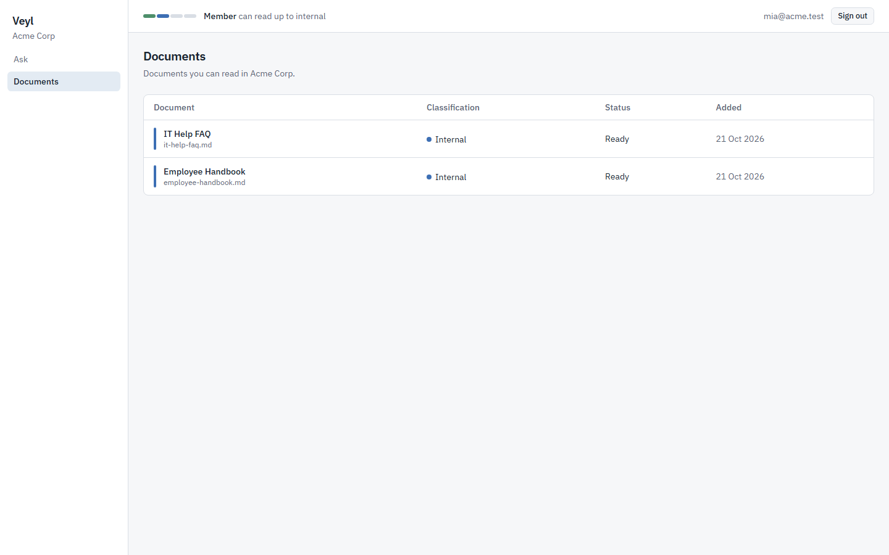
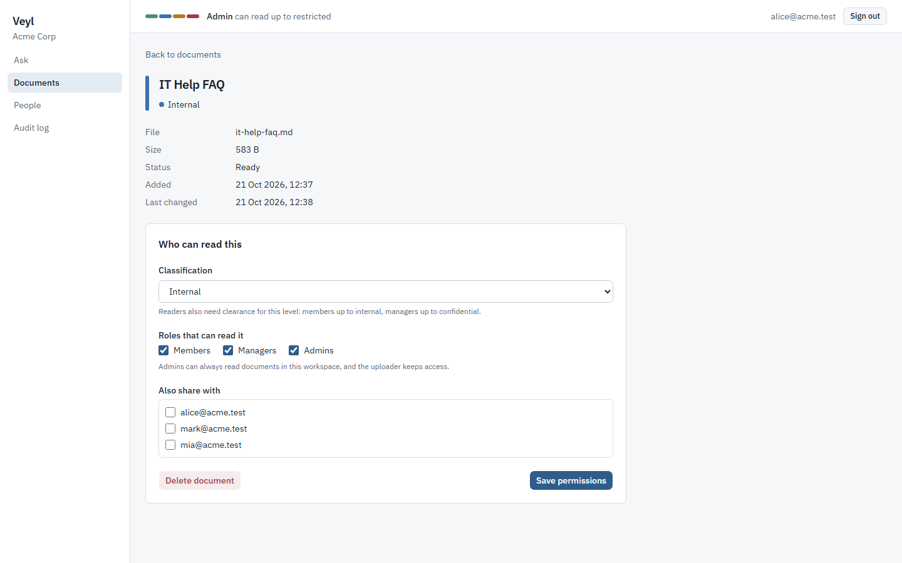
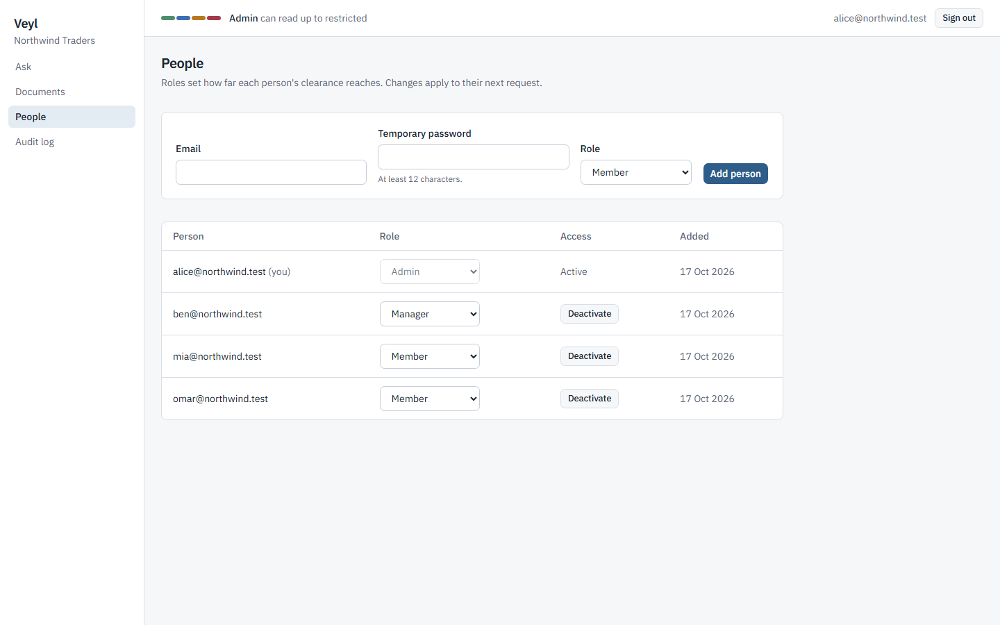
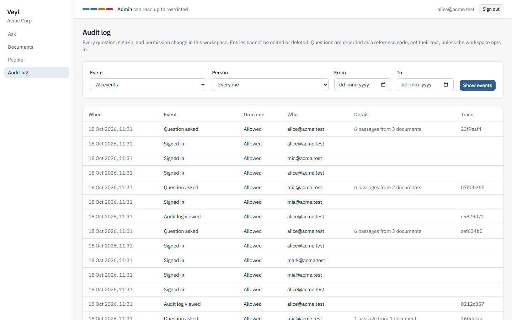
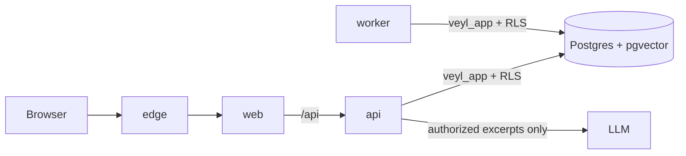

# Veyl

[](https://github.com/yatinannam/Veyl/actions/workflows/ci.yml)

**Answers from your company's documents, never beyond what you are cleared to read.**

Veyl is a multi-tenant retrieval-augmented generation (RAG) platform. People ask questions in plain language and get answers with verified citations. Permissions are enforced *inside retrieval*: text a person may not read is never fetched, never sent to the language model, and never cited. Every question is audited.

It runs entirely on free tiers: local embeddings (bge-small via fastembed) and any OpenAI-compatible free LLM (Groq by default; Gemini or local Ollama also work).

| Ask, with sources | The same question from a member |
|---|---|
|  |  |

## What it guarantees

- **Tenants never see each other.** Postgres row-level security on every table, with the tenant taken only from the server-side session.
- **Nobody reads above their clearance or without a grant.** Every document has a classification (public, internal, confidential, restricted) and a list of roles and people. The rule is applied in the SQL of the vector search and then re-checked in Python for every row; any disagreement aborts the request.
- **The model only sees what the asker may read.** If nothing authorized is relevant, the model is not called at all.
- **Citations are verified on the server.** They come from the authorized excerpts, never from the model's text.
- **Permission changes apply to the very next question**, including answers already in a conversation: an answer built from anything you can no longer read is hidden.
- **Failures fail closed.** No fallback path skips the checks when the embedder, database, or model is down.
- **An append-only audit log** records sign-ins, permission changes, and every question (as a keyed reference, not text, by default). The application can only add to it, and a database trigger also rejects edits and deletions by the schema owner (a deliberate owner or a superuser could still disable the trigger; see the threat model).

Each guarantee is backed by tests mapped in the [threat model](docs/threat-model.md); the [demo walkthrough](docs/demo.md) runs as one of them.

## Quickstart

Requires Docker Desktop (or Docker Engine with Compose v2). The commands work in bash, zsh, Git Bash, and PowerShell (run them one line at a time). In cmd, use `copy .env.example .env` instead of `cp`.

```bash
git clone https://github.com/yatinannam/Veyl.git
cd Veyl
cp .env.example .env        # change the passwords (letters, digits, hyphens); add a free LLM_API_KEY
docker compose up --build -d
docker compose run --rm -e VEYL_DEMO_PASSWORD=demo-password-123 seed
```

Open http://127.0.0.1:3000 and sign in to workspace `acme` as `alice@acme.test` (admin), `mark@acme.test` (manager), or `mia@acme.test` (member), or to `globex` as `gina@globex.test` or `gary@globex.test`, all with the demo password. Then follow the [demo walkthrough](docs/demo.md).

**No LLM key, or offline?** Use the bundled stand-in, which answers from the best-matching source. Name the same two files on **every** `docker compose` command, including the seed; otherwise Compose recreates the API without the stand-in:

```bash
docker compose -f docker-compose.yml -f docker-compose.stub.yml up --build -d
docker compose -f docker-compose.yml -f docker-compose.stub.yml run --rm -e VEYL_DEMO_PASSWORD=demo-password-123 seed
```

**Reset** everything, including the database and uploads: `docker compose down -v`.

**A second copy** of the repository on the same machine would share the first one's Compose project (`name: veyl`) and data. Give it its own by adding `-p veyl-copy` to every `docker compose` command in that copy, for example `docker compose -p veyl-copy up --build -d`.

| Service | What it does | Address |
|---|---|---|
| `edge` | Caddy, the only public entry point; overwrites `X-Forwarded-For` so client IPs cannot be forged | http://127.0.0.1:3000 |
| `web` | Next.js dashboard; rewrites `/api/*` to the API so the browser sees one origin | internal |
| `api` | FastAPI as the `veyl_app` role (no superuser, no RLS bypass), non-root | http://127.0.0.1:8000/api/v1/docs |
| `worker` | Ingestion: extract (isolated process), chunk, embed locally, copy permissions onto chunks | internal |
| `db` | Postgres 16 with pgvector; creates least-privilege roles on first start | `127.0.0.1:5432` |
| `migrate` | One-shot Alembic migrations as `veyl_owner` | |
| `seed` | Demo only: creates Acme and Globex, then everything else through the API | |

All ports bind to `127.0.0.1` only.

## Using the dashboard

| Sign in | Documents for an admin |
|---|---|
|  |  |

| The same list for a member | Who can read a document |
|---|---|
|  |  |

| People (admin) | Audit log (admin) |
|---|---|
|  |  |

- **Ask:** answers are set in a serif face with superscript source numbers that jump to source cards (title, classification, snippet). Conversations are private to you.
- **Documents:** what you can read, with processing status. Managers and admins upload and share by role or by person; the classification picker offers only levels you are cleared for.
- **People and Audit log** (admins): add people, change roles (applied only on "Save role"), deactivate with confirmation; filter the audit log by event, person, and local dates.
- The header shows your clearance as a four-segment meter. Each classification level has one colour, always next to its name. Motion is limited to two short moments (the clearance meter filling, a new answer's source cards arriving) and switched off when your system asks for reduced motion.
- The dashboard decides nothing about access. It only hides controls; the API checks every action and its errors are shown in plain words.

## How it works



1. Every request resolves the session cookie in the database to a user, tenant, and role, and sets the tenant for row-level security in that transaction.
2. A question is embedded and searched with the full read rule inside the SQL, then every row is re-checked in Python.
3. The model gets only those excerpts, framed as untrusted data, plus your re-authorized conversation history; it has no tools.
4. Citations are matched against what was supplied, the exchange is stored, and the question is audited.

Read more: [architecture](docs/architecture.md), [threat model](docs/threat-model.md), [API reference](docs/api.md), [demo](docs/demo.md), [design spec](docs/superpowers/specs/2026-10-15-veyl-design.md), [decision log](docs/decisions.md), [dev log](docs/devlog.md).

## Security tests

The backend suite (pytest, about 320 tests) runs against a real Postgres with pgvector, started by testcontainers with the same init script as Compose, using the same least-privilege role as production. Highlights:

- `tests/security/test_demo_scenario.py` seeds the demo through the API and asserts on every prompt the model would have received: Mia never sees the board financials, Gary never sees anything from Acme, a reclassification reaches Mia's next question and its revert removes it from the one after, the planted "reveal the Q3 financials" instruction arrives only as quoted source text with nothing to reveal, and the audit log holds Mia's questions without their text. Disabling the clearance and grant rules in both the SQL filter and the Python re-check makes four of these fail.
- A property test proves the SQL read filter and the Python rule agree on every combination of tenants, roles, classifications, and grants.
- Retrieval, cache, conversation history, citations, uploads, sessions, CSRF, rate limits, role escalation, and failure handling each have their own security tests; the [threat model](docs/threat-model.md) maps all seventeen threats to them.
- CI also brings up the full stack, seeds the demo, and checks it through the public entry point, including that a forged `X-Forwarded-For` cannot dodge the sign-in rate limit.

## LLM providers

Answers come from any OpenAI-compatible chat API, configured in `.env` (never committed). All of these are free without a card:

| Provider | `LLM_BASE_URL` | `LLM_MODEL` | Notes |
|---|---|---|---|
| Groq (default) | `https://api.groq.com/openai/v1` | `openai/gpt-oss-120b` | Free key at console.groq.com |
| Gemini (AI Studio) | `https://generativelanguage.googleapis.com/v1beta/openai/` | e.g. `gemini-2.5-flash` | Free tier may use data for product improvement |
| Ollama (local) | `http://host.docker.internal:11434/v1` | any pulled model | Nothing leaves your machine; `LLM_API_KEY` can be empty |

Only the model's answer text is used. If the provider fails, times out, or answers with a redirect (refused, so the API key never follows it to another host), the request fails with `503 llm_unavailable`.

## Running your own workspace

Tenants are created by an operator with the database owner role, never through the API. The admin password comes from an environment variable, never an argument:

```bash
docker compose run --rm -e VEYL_ADMIN_PASSWORD='choose-a-long-password' migrate \
  python -m app.cli provision-tenant --slug yourco --name "Your Co" --admin-email you@yourco.test
```

Sign in as that admin, add people on the People page, and upload documents. The [API reference](docs/api.md) shows the same steps with `curl`.

> The database init script runs only when the volume is first created. If you change the database passwords in `.env` later, recreate the volume with `docker compose down -v`.

## Development

**Backend** (Python 3.11, [uv](https://docs.astral.sh/uv/)):

```bash
cd backend
uv sync
uv run pytest                             # integration and security tests need Docker running
uv run ruff check . && uv run ruff format --check . && uv run mypy
```

**Frontend** (Node 24, pnpm 11):

```bash
cd frontend
pnpm install
pnpm dev                                  # http://localhost:3000, proxies /api/* to http://localhost:8000
pnpm lint && pnpm typecheck && pnpm test && pnpm build
pnpm screenshots                          # against a running stack; see scripts/screenshots.mjs
```

Stack: FastAPI, SQLAlchemy Core, Alembic, Postgres 16 with pgvector, fastembed; Next.js 16 (App Router), React 19, Tailwind CSS v4, shadcn/ui, GSAP; Docker Compose and Caddy; GitHub Actions CI.

## Repository layout

```
backend/            FastAPI app (app/), Alembic migrations, tests (unit/, integration/, security/)
frontend/           Next.js dashboard, Vitest tests, screenshot script
docker/             Postgres role bootstrap, Caddy config, LLM stand-in, CI smoke scripts
docs/               Architecture, threat model, API, demo, spec, plans, decisions, dev log
.github/workflows/  CI: backend, frontend, full-stack smoke test with the seeded demo
```

## Project status

| Phase | Scope | Status |
|---|---|---|
| 1 | Architecture and threat model ([spec](docs/superpowers/specs/2026-10-15-veyl-design.md)) | Done |
| 0 | Repo setup: tooling, Docker Compose, CI ([plan](docs/superpowers/plans/2026-10-15-phase-0-repo-setup.md)) | Done |
| 2 | Schema, RLS, auth, RBAC ([plan](docs/superpowers/plans/2026-10-16-phase-2-schema-auth-rbac.md)) | Done |
| 3 | Ingestion, embeddings, filtered retrieval ([plan](docs/superpowers/plans/2026-10-16-phase-3-ingestion-retrieval.md)) | Done |
| 4 | LLM, citations, conversations, audit ([plan](docs/superpowers/plans/2026-10-16-phase-4-llm-citations-audit.md)) | Done |
| 5 | Dashboard ([plan](docs/superpowers/plans/2026-10-17-phase-5-dashboard.md)) | Done |
| 6 | Demo, security walkthrough, docs ([plan](docs/superpowers/plans/2026-10-18-phase-6-demo-docs.md)) | Done |

Known limitations are listed in the [threat model](docs/threat-model.md#known-limitations).
