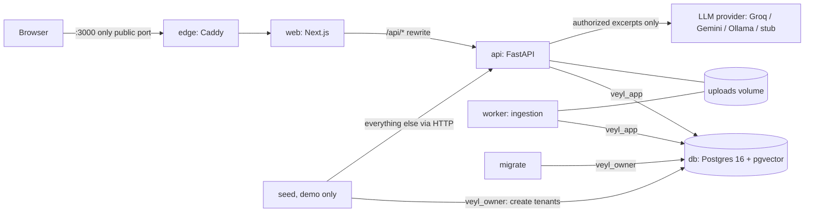
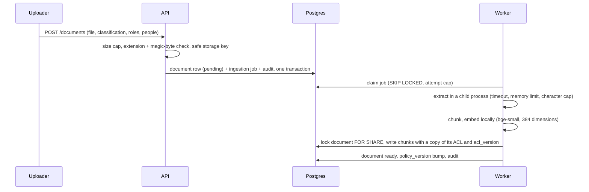

# Architecture

Veyl answers questions over a company's documents and guarantees that text a person may not read never reaches the language model or the person. This page describes how the pieces fit and where each permission check lives. The full reasoning is in the [design spec](superpowers/specs/2026-10-15-veyl-design.md); decisions are in the [decision log](decisions.md).

## Components and trust boundaries

| Component | Runs as | Trust and responsibility |
|---|---|---|
| `edge` (Caddy) | public entry point, port 3000 on localhost | Overwrites `X-Forwarded-For` so the API's per-IP login limit sees the real client. |
| `web` (Next.js 16) | not published | Renders the dashboard and rewrites `/api/*` to the API, so the browser sees one origin. Makes no authorization decisions. |
| `api` (FastAPI) | `veyl_app` database role | Authenticates every request, authorizes every action, runs retrieval and the LLM call, writes the audit log. |
| `worker` | `veyl_app` | Claims ingestion jobs, extracts text in an isolated child process, chunks, embeds locally, copies the document's permissions onto each chunk. |
| `db` (Postgres) | roles `veyl_owner`, `veyl_app` | `FORCE ROW LEVEL SECURITY` on every table (the owner passes only through its own explicit policies); the app role has no `BYPASSRLS`, is not a superuser, and has column-level grants. |
| `migrate` | `veyl_owner` | One-shot Alembic migrations; the only service with owner credentials in normal operation. |
| `seed` | `veyl_owner` for tenants, HTTP for the rest | Demo only (profile `demo`). Creates the two tenants, then acts as each admin through the public API. |
| LLM provider | third party (or local) | Sees only the excerpts the asker may read, wrapped as untrusted data. Never sees other tenants' text, unreadable text, or the audit log. |

## Identity on every request

1. The `veyl_session` cookie (opaque, HttpOnly, SameSite=Lax, Secure in production) is hashed with SHA-256 and resolved by a `SECURITY DEFINER` function to user, tenant, role, and session. Unknown, expired, revoked, or deactivated means 401.
2. The result is an `AuthContext`. Tenant and user ids never come from the request body, headers, or query string; request models forbid extra fields.
3. State-changing requests must echo the `veyl_csrf` cookie in `X-CSRF-Token`.
4. Every database transaction for a tenant runs `SET LOCAL app.tenant_id`, and RLS policies compare against it. With no tenant set, every table looks empty.

## Authorization model

- **Roles and clearance:** member (up to internal), manager (up to confidential), admin (up to restricted).
- **Actions** are decided centrally in `app/authz/policy.py` (`authorize`, `is_allowed`, `permissions`). The dashboard only uses the permission list from `/auth/me` to decide what to show.
- **The chunk read rule** (`can_read_chunk` in Python, `chunk_read_filter` in SQL; proven equivalent by a property test): same tenant; classification within the reader's clearance; and the reader is an admin, or has an allowed role, or is named in the allowed users; plus the document is ready, not deleted, and the chunk's `acl_version` matches the document's.

Other guards: admins cannot change their own role or status; a tenant always keeps at least one active admin (checked under a row lock, so concurrent demotions cannot race past it); deactivating someone revokes their sessions; role and status changes bump the tenant's `policy_version`. Passwords are argon2id (at least 12 characters), unknown accounts still pay the hashing cost, and at most four hashes run at once. Session tokens are 256-bit random values stored only as SHA-256 digests.

Where each check lives:

| Layer | Enforces |
|---|---|
| Postgres RLS | Tenant boundary on every table, for every query, including bugs in application SQL. |
| SQL filter inside the vector search | The full chunk read rule, so unauthorized chunks are never returned by the database. |
| Python re-check of every returned row | The same rule again; any disagreement aborts the request (`500 authorization_mismatch`). |
| Service functions | Actions (`authorize`), ownership of conversations, managers capped at their own clearance and their own documents. |
| Dashboard | Nothing; hides controls as a convenience. |

## Ingestion

Details:

- **Uploads:** PDF, TXT, and Markdown only; the extension must match the content (a PDF starts with `%PDF-`; text is valid UTF-8 without NUL bytes). `MAX_UPLOAD_MB` (default 10) is enforced while the body streams in, without trusting `Content-Length`. Originals are stored under `UPLOAD_DIR/<tenant_id>/<document_id>`; the uploaded filename is display metadata only.
- **Chunking:** paragraphs, then sentences, then hard cuts, about 800 characters with about 120 of overlap; a Markdown heading starts a new chunk.
- **Retries:** unreadable or encrypted files fail at once with a message the uploader sees; other errors retry up to 3 times with backoff; a job whose worker died is reclaimed after 10 minutes, and failed after 3 attempts.
- **Embeddings:** `BAAI/bge-small-en-v1.5` via fastembed (ONNX), baked into the image and run offline. No API key, $0.

A permission change rewrites every chunk's copy of the ACL in the same transaction, bumps the document's `acl_version` (stale chunks become invisible) and the tenant's `policy_version` (cached results stop matching).

## Answering a question

`POST /api/v1/query` (`app/rag/service.py`):

1. Check the `rag.query` action. If a conversation id is given, it must belong to the caller (otherwise 404, audited as `rag.denied`).
2. Load the conversation history and re-authorize it: an earlier answer is replayed only if every chunk it was built from, cited or not, is still readable now.
3. Retrieve in one tenant transaction: read `policy_version`, look up the ids-only cache (keyed by tenant, user, policy version, model, query, `top_k`, minimum score), otherwise embed the question and run the vector search with the read filter inside SQL. Re-check every row in Python.
4. If nothing authorized clears the minimum similarity score (0.5 by default), answer "nothing found" without calling the model.
5. Build the prompt: a fixed system prompt that treats sources as untrusted data, each excerpt in a neutralised `<source id="S1" title="...">` block, the re-authorized history, the question. The model has no tools.
6. Keep only `[S#]` markers that map to supplied sources; renumber them S1..Sn by first use; build citations (title, classification, snippet) from the authorized rows, never from model text.
7. Store both messages (with every chunk the model saw) and the audit event in one transaction. The question is stored in the audit log as an HMAC reference unless the tenant opts into plaintext.

Every failure (embedding, database, model) is an error response with an audit record, never a fallback that skips the filter.

## Data model (summary)

`tenants`, `users`, `sessions`, `documents` (classification, allowed roles, allowed users, status, `acl_version`), `document_chunks` (content, embedding, a copy of the ACL, `acl_version`), `ingestion_jobs`, `conversations`, `messages` (cited and source chunk ids), `retrieval_cache` (chunk ids only), `audit_events` (append-only for the app role; a trigger rejects UPDATE, DELETE, and TRUNCATE by any role, though the schema owner could disable it). Every table carries `tenant_id` and an RLS policy. The ER diagram is in spec section 5.2.

## Frontend

Client components call the API through the same-origin `/api/v1` rewrite with a small typed client that echoes the CSRF cookie. `proxy.ts` sends requests without a session cookie to `/login`; any 401 after that sends the user to sign in and back. Classification levels have one colour each, always next to their name. Motion (GSAP) is limited to two moments (the clearance meter, a new answer's source cards), both for content that arrives after the page loads, and is disabled under reduced motion.

## Where to look

| Concern | Code |
|---|---|
| Policy and read rule | `backend/app/authz/` |
| Sessions, CSRF, rate limits | `backend/app/auth/` |
| Tenant transactions, RLS helpers | `backend/app/db/tenancy.py`, `backend/migrations/` |
| Upload validation, storage | `backend/app/documents/` |
| Worker pipeline | `backend/app/ingestion/`, `backend/app/worker.py` |
| Retrieval and cache | `backend/app/retrieval/search.py` |
| Prompt, citations, LLM client | `backend/app/llm/` |
| Query pipeline | `backend/app/rag/service.py` |
| Audit log | `backend/app/audit/` |
| Demo seed | `backend/app/demo/` |
| Dashboard | `frontend/src/` |
