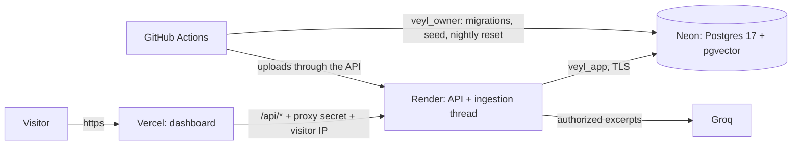

# Deploying the public demo

Veyl's public demo runs entirely on free plans with no card: **Neon** (Postgres with pgvector), **Render** (the API, with the ingestion worker on a thread of the same process), **Vercel** (the dashboard), and **GitHub Actions** (database setup, seeding, and a nightly reset). The design and its trade-offs are in the [hosting plan](superpowers/plans/2026-10-21-hosting.md) and decisions D-053 to D-055.

## What goes where

Never paste these values into an issue, a chat, or a commit. Each lives only in the place listed.

| Value | Where it lives | How to make it |
|---|---|---|
| Neon admin connection string | GitHub secret `NEON_ADMIN_URL` | Neon console, role `neondb_owner`, pooling off |
| Owner password | GitHub secret `VEYL_OWNER_PASSWORD` | `python -c "import secrets; print(secrets.token_urlsafe(32))"` |
| App password | GitHub secret `VEYL_APP_PASSWORD`, and inside Render's `DATABASE_URL` | same command |
| Proxy secret | Render `PROXY_SHARED_SECRET` and Vercel `PROXY_SHARED_SECRET` (identical) | same command |
| Groq API key | Render `LLM_API_KEY` | console.groq.com |
| Audit key | Render `AUDIT_HMAC_KEY` | generated by Render |
| Demo password | GitHub variable `VEYL_DEMO_PASSWORD`, Vercel `NEXT_PUBLIC_DEMO_PASSWORD` | public by design; 12+ characters |
| API address | GitHub variable `VEYL_API_URL`, Vercel `API_INTERNAL_URL` | Render shows it |

The serving API holds only the application role (`veyl_app`); the owner password exists only in GitHub Actions.

## 1. Database (Neon)

1. In the Neon console, create a project named `veyl` with **Postgres 17** in **AWS Asia Pacific (Singapore)** (any region works; keep Render in the matching one).
2. Under **Connect**, choose role `neondb_owner` and database `neondb`, turn **Connection pooling off**, and copy the connection string.
3. Make the owner and app passwords with the command in the table above.
4. In the GitHub repository: **Settings**, **Secrets and variables**, **Actions**, **Secrets** tab, **New repository secret**: add `NEON_ADMIN_URL`, `VEYL_OWNER_PASSWORD`, `VEYL_APP_PASSWORD`.
5. **Actions** tab, **Database setup**, **Run workflow**. A green run ends with an "API connection string" line, `postgresql://veyl_app:<VEYL_APP_PASSWORD>@.../neondb?sslmode=require...`. Keep it.

Run **Database setup** again after any release that adds a migration; it is safe to repeat.

## 2. API (Render)

1. Make the proxy secret with the same command, and keep it for this step and step 4.
2. In Render: **New**, **Blueprint**, connect GitHub, and pick this repository. Render reads [`render.yaml`](../render.yaml) and shows one free web service, `veyl-api`, in Singapore.
3. Fill in the three values it asks for:
   - `DATABASE_URL`: the API connection string from step 1, with the app password in place of `<VEYL_APP_PASSWORD>`.
   - `PROXY_SHARED_SECRET`: the proxy secret.
   - `LLM_API_KEY`: your Groq key.
4. **Apply**. The first build takes about ten minutes (the embedding model is built into the image). Wait until the service says **Live**.
5. Copy the service address, such as `https://veyl-api.onrender.com`, and check `https://<address>/api/v1/readyz` shows `{"status":"ready"}`.

Render deploys again only when a commit that changes `backend/` passes CI.

## 3. Demo data (GitHub Actions)

1. Choose the demo password. It is shown on the sign-in page, so make it something you are happy to publish (12+ characters).
2. **Settings**, **Secrets and variables**, **Actions**, **Variables** tab, **New repository variable**:
   - `VEYL_API_URL`: the Render address, without a trailing slash.
   - `VEYL_DEMO_PASSWORD`: the demo password.
3. **Actions** tab, **Seed demo**, **Run workflow**. It wakes the API, creates Acme and Globex, uploads their documents through the API, and waits until each is processed (a few minutes on Render's free CPU). It ends with "Demo ready".

## 4. Dashboard (Vercel)

1. In Vercel: **Add New**, **Project**, import this repository.
2. Set **Root Directory** to `frontend`. Vercel detects Next.js.
3. Under **Environment Variables**, add:
   - `API_INTERNAL_URL`: the Render address.
   - `PROXY_SHARED_SECRET`: the same proxy secret as on Render.
   - `NEXT_PUBLIC_DEMO_PASSWORD`: the demo password.

   [`frontend/vercel.json`](../frontend/vercel.json) runs the install and build with the pnpm version the project pins, so nothing else needs configuring.
4. **Deploy**. Open the address Vercel gives you. The sign-in page lists the demo accounts; click one.

If the API was asleep, the dashboard says "Starting up, this can take a minute" and continues on its own.

## 5. Nightly reset

**Reset demo** runs every night at 20:30 UTC (02:00 in India) and can be run by hand from the Actions tab. It:

- gives every seeded person their role, active state, and the demo password back, and removes anyone visitors added;
- keeps one unchanged copy of each seed document and removes everything else; documents that were deleted or re-shared are uploaded again through the API;
- ends every session and removes every conversation and cached retrieval;
- restores the workspace name and audit setting;
- never removes audit records; it adds one "Demo reset" event per company.

GitHub pauses scheduled workflows in a repository with no activity for 60 days; re-enable **Reset demo** from the Actions tab if that happens.

## Checking a deployment

**Live check** (Actions tab, manual; give it the dashboard address) confirms the dashboard reaches the API and that 21 failed sign-ins through the dashboard, each with a forged `X-Forwarded-For`, end in 429. Afterwards, sign in from your own browser: if that works while GitHub's runner is blocked, the limit is per visitor, which also proves the proxy secrets on Render and Vercel match.

## Limits of the free plans

- **Cold starts.** Render stops the API after 15 minutes without traffic, and Neon suspends the database after 5. The first request afterwards takes up to about a minute (35 seconds measured for a sign-in).
- **Uploads are temporary files.** Render's disk is wiped on every restart. Text is extracted and embedded shortly after upload and lives in the database, so answers keep working; an upload still waiting when the service sleeps fails and can be uploaded again.
- **Small and slow.** 0.1 CPU and 512 MB: uploads are limited to 4 MB and 25 documents per company, and processing takes seconds rather than milliseconds.
- **Groq's free tier** has per-minute limits; when it is busy, the API answers "the answer service is unavailable" rather than anything less safe.

## Troubleshooting

| Symptom | Cause and fix |
|---|---|
| Database setup fails with `OperationalError` | `NEON_ADMIN_URL` is the pooled string or is missing `sslmode=require`; copy it again with pooling off. |
| Render deploy fails at start with a settings error | A prompted value is missing or `PROXY_SHARED_SECRET` is shorter than 32 characters. |
| `readyz` shows `unavailable` | The API cannot reach the database. Open the service's **Logs** in Render and find `readiness check failed: database unreachable (...)`: the part in brackets is the database's own reason, with passwords removed. `password authentication failed`: the password inside `DATABASE_URL` is not `VEYL_APP_PASSWORD` (re-run **Database setup**: its `check: veyl_app can sign in` line proves the secret works, so the Render value was mistyped; it must contain no `<`, `>`, quotes, or spaces). `could not translate host name` or `timeout`: the host part was changed or Neon is waking; try again after a minute. |
| Seed says "Demo already seeded" | It was seeded before; run **Reset demo** instead. |
| Sign-in fails with every demo account | `VEYL_DEMO_PASSWORD` and `NEXT_PUBLIC_DEMO_PASSWORD` differ; fix one, then run **Reset demo** (and redeploy Vercel if you changed its value). |
| Vercel install fails with `ERR_INVALID_THIS` or "Ignoring not compatible lockfile" | An old pnpm ran instead of the pinned one: check **Root Directory** is `frontend` (so `vercel.json` is read) and that no Install Command override is set in the project settings. |
