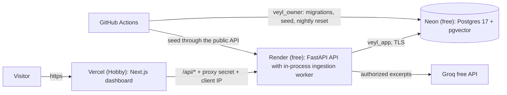

# Hosting: a free public demo

> **For agentic workers:** REQUIRED SUB-SKILL: Use superpowers:executing-plans to implement this plan task-by-task. Steps use checkbox (`- [ ]`) syntax for tracking.

**Goal:** Veyl runs publicly for $0 with no card: anyone can open the dashboard, sign in with the published demo accounts, and do the whole walkthrough; the demo resets itself every night.

**Architecture:**

- **Neon** hosts the database. A one-time bootstrap creates the same two least-privilege roles as Compose, using Neon's admin role (which can create roles but is not a superuser).
- **Render** runs one free web service: the API with the ingestion worker in a background thread of the same process, so one copy of the embedding model is shared in about 512 MB of memory. It never holds owner credentials.
- **Vercel** serves the dashboard. Its `proxy.ts` forwards `/api/*` to Render and adds a shared secret plus the visitor's IP (Vercel overwrites `X-Forwarded-For`, so it cannot be spoofed); the API trusts that IP only when the secret matches.
- **GitHub Actions** holds the owner credentials, runs migrations, seeds the demo, and resets it nightly.

**Tech Stack:** as the project, plus Render Blueprints (`render.yaml`), Vercel project settings, GitHub Actions secrets and schedules.

**Spec:** `docs/superpowers/specs/2026-10-15-veyl-design.md`; decision D-009 (local Compose only) is superseded by this plan.

## Global Constraints

- $0 and no card anywhere; every service on its free tier.
- Secrets are entered by the user in each provider's dashboard or GitHub secrets, never pasted into chat or committed. The demo password is public by design.
- The serving API never holds the database owner's credentials; only GitHub Actions does.
- Local Compose keeps working exactly as before; hosting adds options, it does not change defaults.
- Every commit updates `README.md` and `docs/devlog.md`; pause after each batch for the user's go-ahead.

## Review Focus

1. **Forged client IP on the public API:** a request straight to the Render URL with a fake `X-Forwarded-For` or a fake client-IP header must not move the rate-limit key; only the secret-bearing proxy may set it.
2. **Memory:** API, worker thread, embedding model, and a PDF extraction child process must fit in 512 MB during the seed and a query.
3. **Cold start:** the first request after Render or Neon slept must succeed (slowly), not fail; the dashboard should say it is waking up.
4. **Visitor abuse of the open demo:** uploads are capped per workspace; visitors can create people and change permissions, and the nightly reset restores the seeded state even if they demoted the admin.
5. **Neon specifics:** no superuser, TLS required, connection strings in `postgresql://` form, roles needing strong passwords.

## Batches

### Batch H1: Database bootstrap for managed Postgres

- [ ] Tests: on the test database, a non-superuser admin role (CREATEROLE, owner of a fresh database, extensions already present) runs `python -m app.cli bootstrap-database`; migrations then run as the new `veyl_owner`; the app role has the same guarantees as under Compose (no BYPASSRLS, cannot create tables or temp tables, cannot execute owner functions not granted). Running it twice changes nothing. `postgresql://` URLs are accepted (normalised to the psycopg driver).
- [ ] Implement the command (admin part as the admin role; default-privilege part as `veyl_owner`), reusing the role rules of `docker/postgres/init/01-roles.sh`; skip the maintenance-database revokes where the admin role cannot apply them, and say so.

### Batch H2: One free service for the API

- [ ] Tests: with `RUN_INGESTION_WORKER=true` the API process ingests uploads in a background thread that stops cleanly; client IP comes from `X-Veyl-Client-IP` only with the correct `X-Veyl-Proxy-Secret`, otherwise from the right-most `X-Forwarded-For` entry or the peer; `MAX_DOCUMENTS_PER_WORKSPACE` refuses uploads beyond the cap.
- [ ] Start command honours `PORT`; uvicorn no longer trusts forwarded headers itself; Compose and CI keep passing.
- [ ] Measure: the backend image under `--memory=512m` seeds the demo and answers a question.

### Batch H3: Dashboard for Vercel

- [ ] Tests: `proxy.ts` forwards `/api/*` to `API_INTERNAL_URL` with the secret and the visitor IP; a waking API shows "Starting up, this can take a minute" instead of an error; with `NEXT_PUBLIC_DEMO_PASSWORD` set, the sign-in page shows the demo accounts.
- [ ] Fonts bundled locally (no build-time download).

### Batch H4: Demo operations and deployment files

- [ ] Tests: `python -m app.cli reset-demo` restores the seeded state after visitors changed roles, deactivated or added people, uploaded or deleted documents, and changed permissions; sessions are revoked; it never deletes audit records.
- [ ] `render.yaml` (Blueprint), GitHub workflows `database-setup.yml` (manual), `seed-demo.yml` (manual), `reset-demo.yml` (nightly and manual), and `docs/deploy.md` with step-by-step instructions for Neon, GitHub, Render, and Vercel.

### Batch H5: Go live

- [ ] The user follows `docs/deploy.md`; I verify the live demo end to end (walkthrough, rate limit from outside, cold start), take screenshots, and add the live link to the README.
